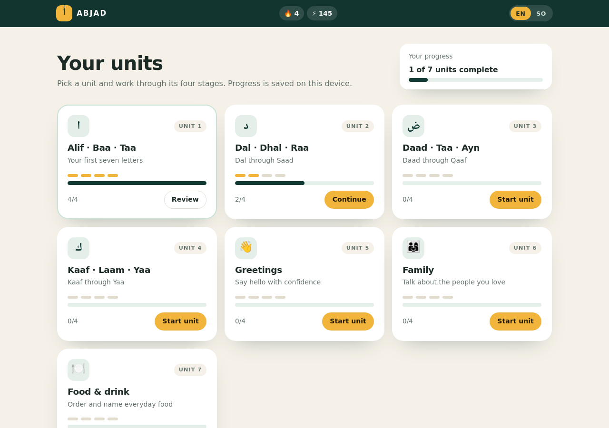
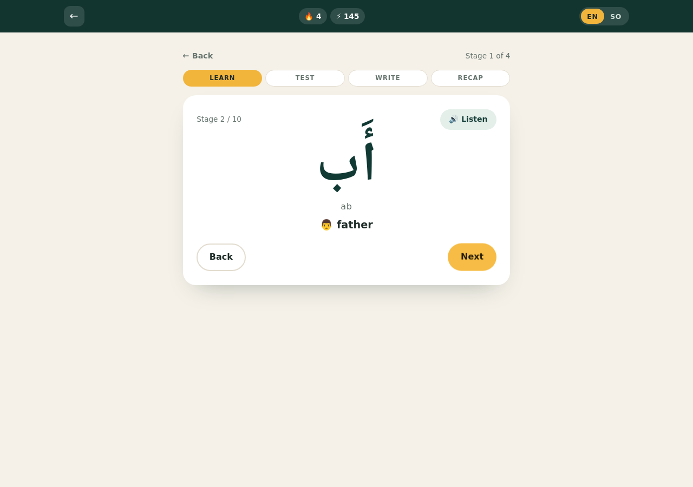
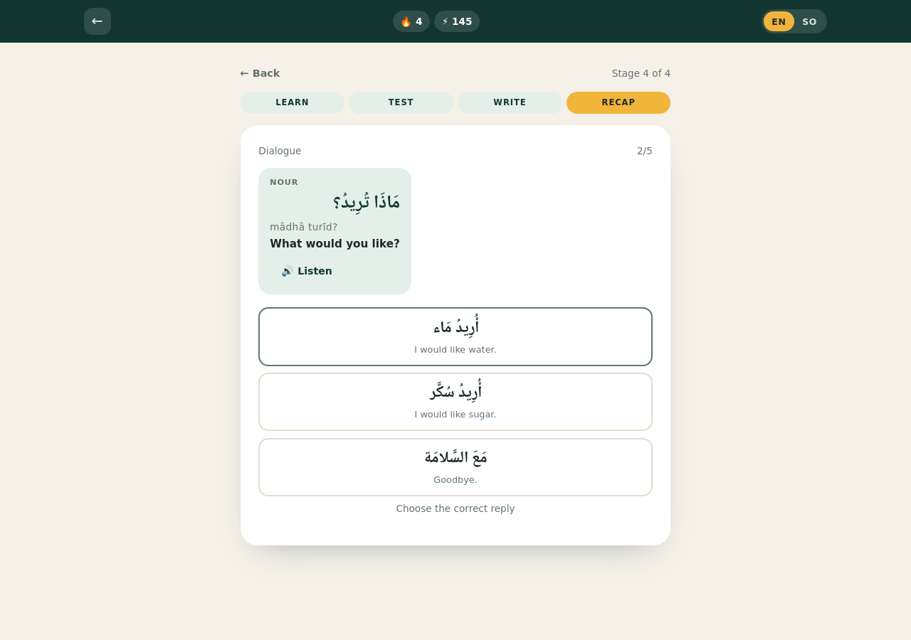
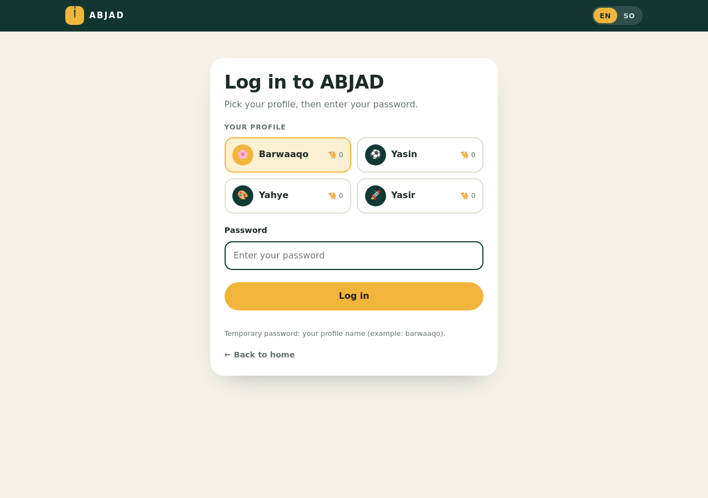
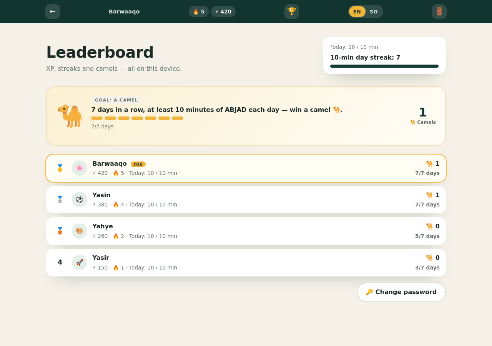
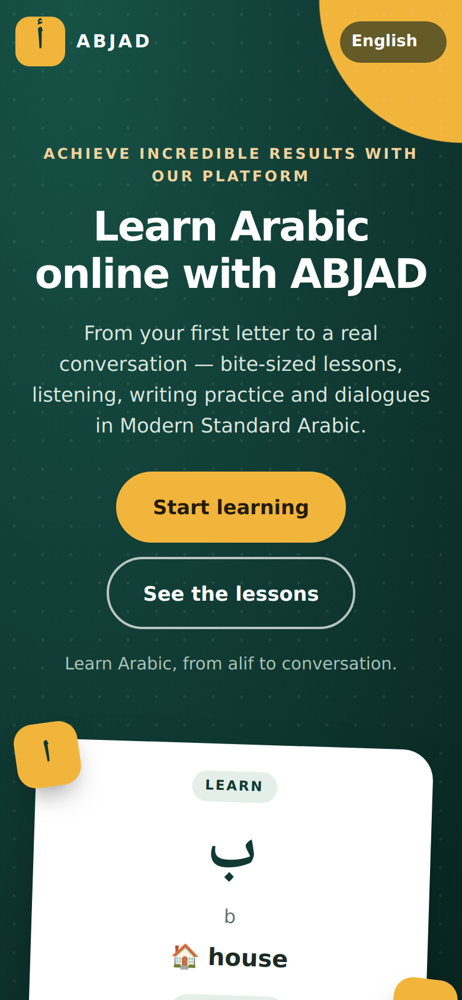

# ABJAD — Baro Carabiga (English + Soomaali)

ABJAD waa **Progressive Web App (PWA)** lagu baranayo **Carabiga caadiga ah (Modern Standard Arabic)**. Wuxuu leeyahay manhaj xaraf-xaraf, layliyo qoraal, dhageysi, iyo wadahadal gaaban. Interface-ka wuxuu ku shaqeeyaa **Ingiriisi** iyo **Soomaali**, horumarkaana wuxuu ku kaydsan yahay qalabkaaga — server ama akoon looma baahna.

> **Xusuusin:** Mashruucan waa mid asli ah oo ka faa'iideystay *qaabka waxbarasho* ee AlifBee (website + Play Store listing). **Ma xirna AlifBee**, lamana koobiyaan koodhkooda, sawirradooda, ama nuxurkooda.


| Dashboard | Cashar |
|---|---|
|  |  |

| Qoris | Wadahadal |
|---|---|
|  |  |

| Login (profiles) | Leaderboard & geel |
|---|---|
|  |  |



---

## 1. Waxa ku jira

- **4 profile carruur** — Barwaaqo, Yasin, Yahye, Yasir — mid kastaa leh passphrase u gaar ah (PBKDF2 hash, qalabka gudihiisa).
- **Leaderboard & geel** — 7 maalmood × 10 daqiiqo = neef geel 🐪; XP iyo streak-na waa la tartamaa.
- **7 cutub, 58 shay, 28 xaraf Carabi** oo dhamaystiran.
- **4 marxaladood cutub kasta:**
  1. **Baro** — erey/xaraf, dhawaaq, macne, tusaale.
  2. **Tijaabo** — su'aalo doorasho leh (Carabi → macne iyo macne → Carabi).
  3. **Qoris** — ereyada lagu dhiso xarfo isku qasan; xarfaha waxaa lagu tijaabiyaa dhageysi.
  4. **Dib u celin** — wadahadal (cutubada salaamaha/qoyska/cuntada) ama quiz recap.
- **Labada luuqadood** — Ingiriisi default, Soomaali badhanka `SO`; tarjumaad kasta waa la beddeli karaa wakhti kasta.
- **Cod Carabi** — `speechSynthesis` (browser voice) haddii uu qalabkaagu taageero.
- **XP, streak maalmeed, horumar** — `localStorage`.
- **Offline / PWA** — service worker, font Carabi gudaha, install Chrome/Edge.
- **Responsive** — mobile iyo desktop.
- **Local link hub** — `links.html` oo leh link kasta oo cutub/marxalad ah.

---

## 2. Bilowdeg deg ah

### A. Browser kaliya (file://)

`index.html` laba-guji. Wixii barasho wuu shaqeeyaa, laakiin **PWA/offline ma shaqeeyaan** marka `file://` la isticmaalo.

### B. Server maxalli ah (loo talinayaa)

```bash
cd ~/abjad
./serve.sh
```

Kadib fur: **<http://localhost:8090/>** → **Gal** → dooro profile → markii ugu horreysa waxaad dhigataa passphrase-kaaga (ugu yaraan 6 xaraf).

`serve.sh` waa idempotent: haddii server hore u shaqaynayo, isma dilo; haddii kale wuu kiciyaa oo wuxuu daabacaa linkiyada.

### C. Windows launcher

Desktop-ka waxaa yaal `ABJAD.bat` — laba-guji, wuxuu kiciyaa server-ka WSL-ka oo wuxuu ku furayaa browser-ka.

### D. Amar gaar ah (`abjad`)

`~/.local/bin/abjad` waa la rakibay:

```bash
abjad          # kici server + daabac links
abjad --open   # kici + fur browser
ABJAD_PORT=9000 abjad
```

### E. Auto-start (systemd user)

```bash
systemctl --user status abjad.service
systemctl --user restart abjad.service
systemctl --user disable --now abjad.service   # jooji/auto-start dami
```

---

## 3. Linkiyada localhost-ka

Port default: **8090**. (8080 waxaa isticmaala app kale oo `baro-soomaali` — ha isku qaldin.)

| Link | Waxa uu furayaa |
|---|---|
| <http://localhost:8090/> | Bogga hore / landing |
| <http://localhost:8090/#/login> | Login / dooro profile |
| <http://localhost:8090/#/leaderboard> | Tartanka + geel |
| <http://localhost:8090/#/learn> | Cutubabka iyo horumarka |
| <http://localhost:8090/#/lesson/letters-1/0> | Xarfaha 1 — Baro |
| <http://localhost:8090/#/lesson/letters-1/1> | Xarfaha 1 — Tijaabo |
| <http://localhost:8090/#/lesson/letters-1/2> | Xarfaha 1 — Qoris |
| <http://localhost:8090/#/lesson/letters-1/3> | Xarfaha 1 — Recap |
| <http://localhost:8090/#/lesson/food/3> | Cunto — Wadahadal |
| <http://localhost:8090/links.html> | **Link hub** (cutub kasta + reset progress) |

Qaabka URL-ka:

```
#/lesson/<unit-id>/<stage-index>
stage 0 = learn, 1 = quiz, 2 = write, 3 = recap
```

Port beddel:

```bash
ABJAD_PORT=9100 ./serve.sh
# -> http://localhost:9100/
```

---

## 4. Manhajka hadda

| # | Cutub | Nooca | Shay |
|---|---|---|---|
| 1 | Alif · Baa · Taa | xaraf | 7 |
| 2 | Dal · Dhal · Raa | xaraf | 7 |
| 3 | Daad · Taa · Ayn | xaraf | 7 |
| 4 | Kaaf · Laam · Yaa | xaraf | 7 |
| 5 | Greetings / Salaamaha | erey | 10 + wadahadal |
| 6 | Family / Qoyska | erey | 10 + wadahadal |
| 7 | Food & drink / Cunto | erey | 10 + wadahadal |

Xarfaha waxay leeyihiin **qaabab** (isolated/initial/medial/final) iyo **tusaale** (erey + macne + emoji).

---

## 5. Profiles, login & leaderboard

### Profiles-ka carruurta

| Magac | Username |
|---|---|
| Barwaaqo | `barwaaqo` |
| Yasin | `yasin` |
| Yahye | `yahye` |
| Yasir | `yasir` |

- Login: `#/login` → dooro profile-ka → geli passphrase-ka.
- **Gelitaanka koowaad**: profile kastaa wuxuu leeyahay passphrase u gaar ah oo adiga dhigta (ugu yaraan 6 xaraf) — ma jiro password wadaag ah.
- Passphrase-ka waxaa lagu kaydiyaa **PBKDF2-SHA256** (150,000 round, salt random); plaintext lama kaydiyo (`passphrase.js`).
- Beddel passphrase: leaderboard → **Beddel passphrase**.
- Logout: badhanka 🚪 ee header-ka.
- Profile kastaa wuxuu leeyahay XP, streak, `done`, `days` iyo `camels` **gaar**.
- Xogtu waa **local** (localStorage) — server ma jiro, marka passphrase-ku qalabkan ayuu ku xiran yahay.
- Passphrase la iloobay: DevTools → Application → Local Storage → `abjad.v2` → `users` → tirtir `pwh`-ga profile-kaas (wuu ku weydiin doonaa mid cusub), ama `links.html` → reset (wax walba tirtiraya).

### Leaderboard & geel

- Bogga: `#/leaderboard` (ama 🏆 header-ka).
- Kala-saarista: **geel** → **XP** → magac.
- Hadaf: **7 maalmood oo isku xigta**, maalin kasta **10 daqiiqo** ABJAD.
- Daqiiqadaha waxaa la tiriyaa kaliya marka profile-ku galan yahay, tab-ku muuqdo, route-ku yahay `#/learn` ama `#/lesson/...`, oo dhaqdhaqaaq dhacay 5 daqiiqo gudahood.
- Tick = 15 ilbiriqsi; 10 daqiiqo = 600 ilbiriqsi.
- 7 maalmood → **1 geel**; 14 → 2; 21 → 3, iwm.
- Geel kama tago haddii streak jabo — waa trophy.
- Marka 7-da maalmood la gaaro waxaa soo baxa toast: **"🐪 Waxaad heshay neef geel!"**

> Xogtu waa qalab-kan kaliya; ma jiro server ama sync. Carruurtu waa in ay isla browser-kaas isticmaalaan.

---

## 6. Qaab dhismeedka faylasha

```
abjad/
├── index.html              # shell-ka app-ka
├── styles.css              # design tokens + dhammaan styles
├── app.js                  # router, views, state, event handlers
├── engine.js               # quiz/write generators, streak, camel days
├── curriculum.js           # xogta cutubada (units/cards/dialogues)
├── users.js                # 4 profiles (magac, avatar)
├── i18n.js                 # container-ka I18N
├── en.js                   # 130 string Ingiriisi
├── so.js                   # 130 string Soomaali
├── manifest.webmanifest    # PWA metadata
├── sw.js                   # offline cache
├── links.html              # local link hub
├── serve.sh                # server launcher (port 8090)
├── selfcheck.mjs           # tests (Node)
├── LICENSE                 # MIT (open source)
├── icon.svg / icon-192 / icon-512
├── fonts/
│   ├── noto-naskh-arabic.woff2
│   └── OFL.txt
└── screenshots/
```

`app.js` waxay isticmaashaa keliya JS caadi ah (classic scripts), sidaas darteed `file://` ayuu ka shaqeeyaa. Ma jiro build step, bundler, ama npm dependency.

---

## 7. Sida loo daro cutub cusub

Wax ka beddel `curriculum.js`, gudaha `units`:

```js
{
  id: "numbers",                    // unique, lowercase
  icon: "١٢٣",                      // emoji ama xaraf
  title: { en: "Numbers", so: "Tirooyinka" },
  subtitle: { en: "Count from one to ten", so: "Ka tir 1 ilaa 10" },
  cards: [
    { id: "wahid", ar: "وَاحِد", tr: "wāḥid", en: "one", so: "kow", emoji: "1️⃣" },
    { id: "ithnan", ar: "اِثْنَان", tr: "ithnān", en: "two", so: "laba", emoji: "2️⃣" }
    // ugu yaraan 4 card (si 4 options loo helo)
  ],
  dialogue: [ /* optional */ ]
}
```

Shuruudaha:

- `id` waa in uu **unique** yahay (selfcheck wuu qaban doonaa).
- `ar`, `tr`, `en`, `so` waa **lagama maarmaan** card kasta.
- Cutub kasta ugu yaraan **4 cards**.
- Emoji waa optional; `forms`/`example` waa optional (xarfaha).

### Wadahadal

```js
dialogue: [
  { who: "npc", ar: "السَّلامُ عَلَيْكُم", tr: "as-salāmu ʿalaykum",
    en: "Peace be upon you.", so: "Nabadgelyo." },
  { who: "you", options: [
      { ar: "وَعَلَيْكُمُ السَّلام", tr: "wa-ʿalaykumu s-salām",
        en: "And peace be upon you.", so: "Nabadgelyo sidoo kale.", correct: true },
      { ar: "شُكْرًا", tr: "shukran", en: "Thank you.", so: "Mahadsanid." },
      { ar: "مَاء", tr: "māʾ", en: "Water.", so: "Biyo." }
  ]}
]
```

Cutub kasta oo `you` leh waa in uu leeyahay **hal** `correct: true`.

---

## 8. Sida loo daro luuqad cusub

Tusaale: Af-Faransiis (`fr`).

1. Samee `fr.js`:
   ```js
   globalThis.I18N.fr = { /* 98 keys, isla en.js */ };
   ```
2. Ku dar `index.html`:
   ```html
   <script src="fr.js"></script>
   ```
3. Ku dar `i18n.js` container: `{ en: {}, so: {}, fr: {} }`.
4. `app.js`:
   - `loadState()`: oggolow `"fr"`.
   - `setLang()`: oggolow `"fr"`.
   - `langSwitch()`: ku dar badhan `FR` ama `<option>`.
5. Ku dar `card.fr` iyo `unit.title.fr`/`subtitle.fr` xogta (ama `field()` fallback en).
6. `selfcheck.mjs` wuxuu isbarbardhigaa `en`/`so`; ku dar `fr` markaad dhamaysato.
7. `manifest.webmanifest` `lang` waa optional.

**Muhiim:** ha beddelin key magacyada — `selfcheck` wuxuu qaban doonaa key qaldan.

---

## 9. Engine-ka layliyada

`engine.js` wuxuu leeyahay functions puur ah (Node iyo browser labadaba):

| Function | Shaqo |
|---|---|
| `makeQuiz(cards, pool, lang, rand, count)` | su'aalo 4-doorasho ah; distractors marka hore cutubkaas, kadib guud |
| `makeWrite(card, pool, rand, lang)` | `tiles` erey dheer, `listen` xaraf keliya |
| `checkTiles(tapped, answer)` | isbarbardhig harakat-la'aan |
| `nextStreak(lastDay, today, current)` | streak maalmeed (maalin isku xigta) |
| `unitPercent` / `nextStageIndex` / `unitsComplete` | horumarka |

**XP:**

- Marxalad **Baro**: +5
- **Tijaabo/Qoris/Recap**: +10 jawaab kasta oo sax ah
- Cutub dhamaystir (4/4 markii ugu horreysay): +20

**Streak:** maalin kasta oo aad marxalad dhamaysato; haddii maalin la seegto, 1 ayuu ka bilaabmaa.

---

## 10. Horumarka (localStorage)

Key: **`abjad.v2`** (qalab kasta oo profile ah):

```json
{
  "lang": "en",
  "currentUser": "barwaaqo",
  "users": {
    "barwaaqo": {
      "id": "barwaaqo", "name": "Barwaaqo", "avatar": "🌸",
      "pwh": { "salt": "…", "hash": "…", "iter": 150000 },
      "xp": 145, "streak": 4,
      "lastDay": "2026-11-19",
      "done": { "letters-1": [0, 1, 2, 3] },
      "days": { "2026-11-20": 600 },
      "camels": 1
    }
  }
}
```

- `days[YYYY-MM-DD]` = ilbiriqsiyada waxbarasho ee maalintaas.
- `camels` = tirada geel (7 maalmood × 10 daqiiqo).
- `done[unitId]` = stage indices 0–3.
- Key-ga hore `abjad.v1` waa legacy; lama tirtiro, laakiin lama isticmaalo.
- Nadiifi: `links.html` → **Nadiifi horumarka**, ama:
  ```js
  localStorage.removeItem("abjad.v2"); location.reload();
  ```

---

## 11. PWA / Offline

- `manifest.webmanifest` — name `ABJAD`, icons 192/512, standalone.
- `sw.js` — cache `abjad-v6` (index, JS, CSS, font, icons, links, users).
- Offline waxay u baahan tahay **http://localhost** ama HTTPS; `file://` kuma shaqayso.
- Markaad fayl beddesho:
  1. Beddel `CACHE` version (tusaale `abjad-v5`).
  2. Hard reload (Ctrl+Shift+R) ama DevTools → Application → Service Workers → Unregister.
- Chrome/Edge: menu → **Install ABJAD**.

---

## 12. Tests

```bash
node selfcheck.mjs
```

Wuxuu qabtaa:

- 7 units / 58 cards / 28 letters
- unique IDs, fields `ar/tr/en/so`
- dialogue: hal jawaab sax ah
- i18n: key parity EN↔SO + placeholders + dhammaan `t("...")` keys
- quiz: 4 options, distinct, hal correct
- write: tiles answer reachable, wrong order rejected
- streak cases
- camel days (7 × 600s, gap, partial day) iyo 4 profiles
- manifest/icons/scripts/font/SW assets jiraan

> Browser E2E (Playwright) waxaa lagu sameeyay gudaha; repo-gan kuma jiro si aan dependency loo kordhin. Haddii aad rabto, `npx playwright` ayaa lagu dari karaa.

---

## 13. GitHub

Repo-gani waa local git repo diyaar u ah push. `gh` CLI (v2.105) waa lagu rakibay `~/.local/bin/gh`.

### A. Hal amar (marka `gh` authenticated)

> Hadda `gh auth status` wuxuu sheegayaa **lama xirmin**. Marka hore ku bilow `gh auth login` (browser ama device code), kadib `./push-github.sh`.

**Windows:** laba-guji `ABJAD-PUBLISH.bat` (Desktop) ama `PUBLISH.bat` (repo) — wuxuu kiciyaa `gh auth login`, kadib wuu abuuraa repo-ga, wuu push-gareynayaa, oo wuu daarayaa Pages.

```bash
./push-github.sh
```

Wuxuu:

1. Hubinayaa `gh auth status`.
2. Abuuraa repo `abjad` (public) haddii uusan jirin.
3. Push `main`.
4. Daarayaa GitHub Pages (build_type=workflow) haddii suurtagal.

### B. Gacan ku haynta

```bash
gh auth login
cd ~/abjad
git remote add origin https://github.com/<USER>/abjad.git
git push -u origin main
```

Kadib GitHub → **Settings → Pages → Source: GitHub Actions**. Workflow-ga `.github/workflows/pages.yml` wuxuu deploy-gareynayaa `main`.

Repo URL: `https://github.com/<USER>/abjad`
Pages URL: `https://<USER>.github.io/abjad/`

> **Auth:** qalabkan `gh` lama xirmin. `gh auth login` waa in aad adigu samaysaa (browser/device code), kadib `push-github.sh` wuu shaqaynayaa.

---

## 14. Design system

Colors-ka waxaa lagu qeexay `styles.css` (`:root`):

| Token | Qiimo | Isticmaal |
|---|---|---|
| `--brand` | `#103a33` | green madow, nav, text |
| `--brand-soft` | `#e4efe9` | backgrounds |
| `--yellow` | `#f2b53c` | CTA, accent |
| `--yellow-soft` | `#fbf0d2` | cards |
| `--bg` | `#f5f1e8` | page background |
| `--ink` | `#1d2b27` | text |
| `--muted` | `#65736d` | secondary text |
| `--ok` / `--bad` | `#1b6b4a` / `#a83a2a` | feedback |

Beddel colors: beddel tokens-ka, `index.html` `theme-color`, `manifest.webmanifest` `theme_color`, iyo `icon.svg`/PNG haddii la rabo. Font Carabi: `fonts/noto-naskh-arabic.woff2` (Noto Naskh Arabic, OFL).

Layout: mobile-first, hero leh gees amber ah iyo dhibco yar; cards radius 24px; buttons pill.

---

## 15. Dhibaatooyin caadi ah

| Dhibaato | Xal |
|---|---|
| `Address already in use` | `ABJAD_PORT=9000 ./serve.sh` (8080 waxaa isticmaala app kale) |
| Boggu madhan / console errors | Fur `http://localhost:8090/`, ma aha `file://` |
| PWA ma install-gareyn karo | Waa in `http://localhost` ama HTTPS la isticmaalo |
| Wax hore ayaa muuqda (cache) | Hard reload; SW unregister; kordhi `CACHE` version |
| Cod Carabi ma maqalayo | Browser voice-ka `ar-SA` ma jiro; qoraalka/transliteration isticmaal |
| Emoji boxes | Qalabka font emoji ma leh (Windows/Android way leeyihiin) |
| Passphrase la iloobay | DevTools → `abjad.v2` → `users` → tirtir `pwh`-ga, ama hub reset |
| Geel ma soo baxo | Hubi 7 maalmood × 600s; daqiiqadaha waxaa la tiriyaa `#/learn`/`#/lesson` oo tab visible |
| Leaderboard 0/7 | Daqiiqadaha maanta wali kama gaarin 10; profile-ka saxda ah geli |
| Font Carabi qaldan | `fonts/` folder waa in uu la socdaa; hard reload |

---

## 16. Wixii aan hadda ku jirin (roadmap)

- Cloud sync (profiles-ka hadda waa local-only).
- Placement test iyo manhaj 10-level ah oo buuxa (halkan 7 cutub ayaa seed ah).
- Speech recognition iyo pronunciation scoring.
- Spaced repetition (SRS) oo rasmi ah.
- Lacag/premium iyo notifications.

---

## 17. Credits

- Manhajka iyo koodhka: mashruuc asli ah oo loo sameeyay Farat.
- Font: **Noto Naskh Arabic** © Noto Project Authors, SIL Open Font License 1.1 (`fonts/OFL.txt`).
- Dhiirrigelin: qaabka waxbarasho ee AlifBee (**ma xirna**; ma jiro asset/koodh la koobiyaay).

---

## 18. Laysinka & ardayda (open source)

Mashruucan wuxuu hoos yimaadaa **MIT License** (`LICENSE`) — ardaydu way:

- copy-gareyn karaan,
- fork-gareyn karaan,
- wax ka beddeli karaan,
- ku baran karaan,
- u isticmaali karaan mashruuc kale,

waa in ay **copyright notice**-ka iyo laysinka ku hayaan. Software-ku waa "as is" — wax dammaanad ah ma jiro.

Tallaabooyin arday:

```bash
git clone https://github.com/<USER>/abjad.git
cd abjad
./serve.sh
# http://localhost:8090/
```

Haddii aad faafiso version cusub, link-ka repo-ga asalka ah ku dar (credit). Font-ka **Noto Naskh Arabic** wuxuu leeyahay laysin gaar ah (OFL 1.1, `fonts/OFL.txt`).

Ammaan: xogta profile-ka iyo passphrase hash-ka (PBKDF2) waa localStorage — server ma jiro, laakiin qof qalabkaaga heli karaa wuu arki karaa xogta. Ha gelin xog dhab ah oo xasaasi ah.

---

<div align="center">

**AI iyo tech af-Soomaali — bilaash.**

<a href="https://www.youtube.com/channel/UC7OY_kBXf3Xr8aDZoc6tXZQ"></a>
<a href="https://somalilibrary.substack.com"></a>
<a href="https://github.com/Faratoon"></a>

</div>
